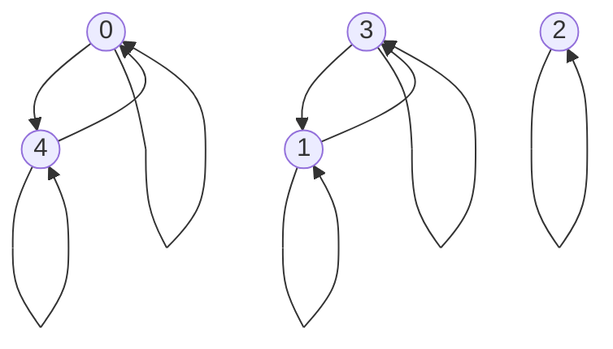

# Equivalence classes of an equivalence relation

Suppose $A$ is a set $R$ is an [[equivalence relation]] on $A$. For each element $a$ in $A$, the **equivalence class of $a$**, denoted $[a]$ and called the **class of $a$** for short, is the set of all elements $x$ in $A$ such that $x$ is related to $a$ by $R$

In symbols

$$
[a] = \{x \in A | xRa\}
$$

## Examples

### Equivalence classes of a relation given as a set of ordered pairs

> [!example] Example: Equivalence classes of a relation
> Let $A = \{0, 1, 2, 3, 4\}$ and define a relation $R$ on $A$ as follows:
>
> $$
> R = \{(0,0),\ (0,4),\ (1,1),\ (1,3),\ (2,2),\ (3,1),\ (3,3),\ (4,0),\ (4,4)\}
> $$
>
> The directed graph for $R$ is shown below. As can be seen by inspection, $R$ is an equivalence relation on $A$. Find the **distinct** equivalence classes of $R$.

> [!success] Solution
> First find the equivalence class of every element of $A$:
>
> $$
> \begin{aligned}
> [0] &= \{x \in A \mid x \mathrel{R} 0\} = \{0, 4\} \\
> [1] &= \{x \in A \mid x \mathrel{R} 1\} = \{1, 3\} \\
> [2] &= \{x \in A \mid x \mathrel{R} 2\} = \{2\} \\
> [3] &= \{x \in A \mid x \mathrel{R} 3\} = \{1, 3\} \\
> [4] &= \{x \in A \mid x \mathrel{R} 4\} = \{0, 4\}
> \end{aligned}
> $$
>
> Note that $[0] = [4]$ and $[1] = [3]$. Thus the *distinct* equivalence classes of the relation are
>
> $$
> \{0, 4\},\quad \{1, 3\},\quad \text{and} \quad \{2\}. \qquad \blacksquare
> $$

### Equivalence classes of congruence modulo 3

> [!example] Example: Equivalence classes of congruence modulo 3
> Let $R$ be the relation of [[congruence]] modulo 3 on the set $\mathbb{Z}$ of all integers. That is, for all integers $m$ and $n$,
>
> $$
> \boxed{m \mathrel{R} n \iff 3 \mid (m - n)}
> $$
>
> Describe the distinct equivalence classes of $R$.

> [!success] Solution
> For each integer $a$,
>
> $$
> \begin{aligned}
> [a] &= \{x \in \mathbb{Z} \mid x \mathrel{R} a\} \\
>     &= \{x \in \mathbb{Z} \mid 3 \mid (x - a)\} \\
>     &= \{x \in \mathbb{Z} \mid x - a = 3k, \text{ for some integer } k\}
> \end{aligned}
> $$
>
> Therefore,
>
> $$
> [a] = \{x \in \mathbb{Z} \mid x = 3k + a, \text{ for some integer } k\}
> $$
>
> In particular,
>
> $$
> \begin{aligned}
> [0] &= \{x \in \mathbb{Z} \mid x = 3k + 0, \text{ for some integer } k\} \\
>     &= \{x \in \mathbb{Z} \mid x = 3k, \text{ for some integer } k\} \\
>     &= \{\ldots, -9, -6, -3, 0, 3, 6, 9, \ldots\} \\[4pt]
> [1] &= \{x \in \mathbb{Z} \mid x = 3k + 1, \text{ for some integer } k\} \\
>     &= \{\ldots, -8, -5, -2, 1, 4, 7, 10, \ldots\} \\[4pt]
> [2] &= \{x \in \mathbb{Z} \mid x = 3k + 2, \text{ for some integer } k\} \\
>     &= \{\ldots, -7, -4, -1, 2, 5, 8, 11, \ldots\}
> \end{aligned}
> $$
>
> Now since $3 \mathrel{R} 0$, then by **Lemma 8.3.2**,
>
> $$
> [3] = [0]
> $$
>
> More generally, by the same reasoning,
>
> $$
> [0] = [3] = [-3] = [6] = [-6] = \ldots, \text{ and so on.}
> $$
>
> Similarly,
>
> $$
> [1] = [4] = [-2] = [7] = [-5] = \ldots, \text{ and so on.}
> $$
>
> And
>
> $$
> [2] = [5] = [-1] = [8] = [-4] = \ldots, \text{ and so on.}
> $$
>
> Notice that every integer is in class $[0]$, $[1]$, or $[2]$. Hence the distinct equivalence classes are
>
> $$
> \begin{aligned}
> &\{x \in \mathbb{Z} \mid x = 3k, \text{ for some integer } k\}, \\
> &\{x \in \mathbb{Z} \mid x = 3k + 1, \text{ for some integer } k\}, \quad \text{and} \\
> &\{x \in \mathbb{Z} \mid x = 3k + 2, \text{ for some integer } k\}.
> \end{aligned}
> $$
>
> In words, the three classes of congruence modulo 3 are:
> 1. the set of all integers that are divisible by 3,
> 2. the set of all integers that leave a remainder of 1 when divided by 3, and
> 3. the set of all integers that leave a remainder of 2 when divided by 3. $\blacksquare$
### Rational numbers are really equivalence classes

> [!example] Example: Equivalence classes of a relation on pairs of integers
> Let $A$ be the set of all ordered pairs of integers for which the second element of the pair is nonzero. Symbolically:
>
> $$
> A = \mathbb{Z} \times (\mathbb{Z} - \{0\})
> $$
>
> Define a relation $R$ on $A$ as follows: For all pairs $(a, b)$ and $(c, d)$ in $A$,
>
> $$
> \boxed{(a, b) \mathrel{R} (c, d) \iff ad = bc}
> $$
>
> The fact is that $R$ is an equivalence relation.
>
> a. Prove that $R$ is transitive. (Proofs that $R$ is reflexive and symmetric are left to exercise 42 at the end of the section.)
> b. Describe the distinct equivalence classes of $R$.

> [!success] Solution
> **a.** *[We must show that for all ordered pairs $(a, b)$, $(c, d)$, and $(e, f)$ in $A$, if $(a, b) \mathrel{R} (c, d)$ and $(c, d) \mathrel{R} (e, f)$, then $(a, b) \mathrel{R} (e, f)$.]*
>
> Suppose $(a, b)$, $(c, d)$, and $(e, f)$ are particular but arbitrarily chosen elements of $A$ such that $(a, b) \mathrel{R} (c, d)$ and $(c, d) \mathrel{R} (e, f)$. *[We must show that $(a, b) \mathrel{R} (e, f)$.]* By definition of $R$,
>
> $$
> (1)\ ad = bc \quad \text{and} \quad (2)\ cf = de
> $$
>
> Since the second elements of all ordered pairs in $A$ are nonzero, $b \neq 0$, $d \neq 0$, and $f \neq 0$. Multiply both sides of equation (1) by $f$ and both sides of equation (2) by $b$ to obtain
>
> $$
> (1')\ adf = bcf \quad \text{and} \quad (2')\ bcf = bde
> $$
>
> Because both equal $bcf$,
>
> $$
> adf = bde
> $$
>
> and, since $d \neq 0$, it follows from the cancellation law for multiplication (T7 in Appendix A) that
>
> $$
> af = be
> $$
>
> Hence, by definition of $R$, $(a, b) \mathrel{R} (e, f)$ *[as was to be shown]*.
>
> **b.** There is one equivalence class for each distinct rational number. Each equivalence class consists of all ordered pairs $(a, b)$ that, if written as fractions $a/b$, would equal each other. The reason is that the condition for two rational numbers to be equal is the same as the condition for two ordered pairs to be related. For instance, the class of $(1, 2)$ is
>
> $$
> [(1, 2)] = \{(1, 2),\ (-1, -2),\ (2, 4),\ (-2, -4),\ (3, 6),\ (-3, -6),\ \ldots\}
> $$
>
> since
>
> $$
> \frac{1}{2} = \frac{-1}{-2} = \frac{2}{4} = \frac{-2}{-4} = \frac{3}{6} = \frac{-3}{-6}
> $$
>
> and so forth. $\blacksquare$